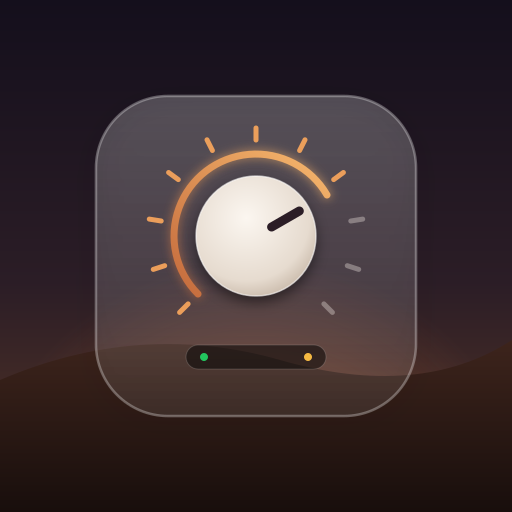
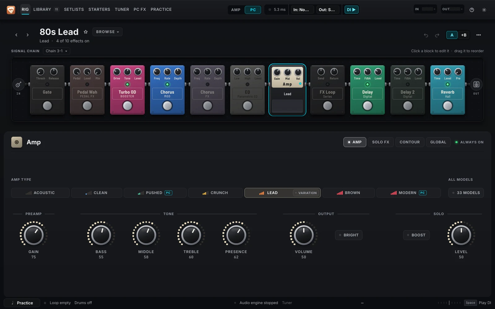
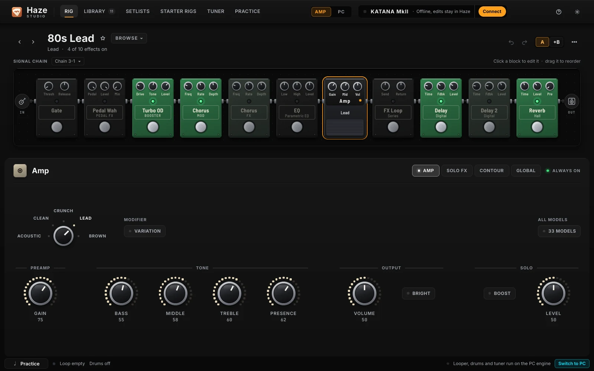
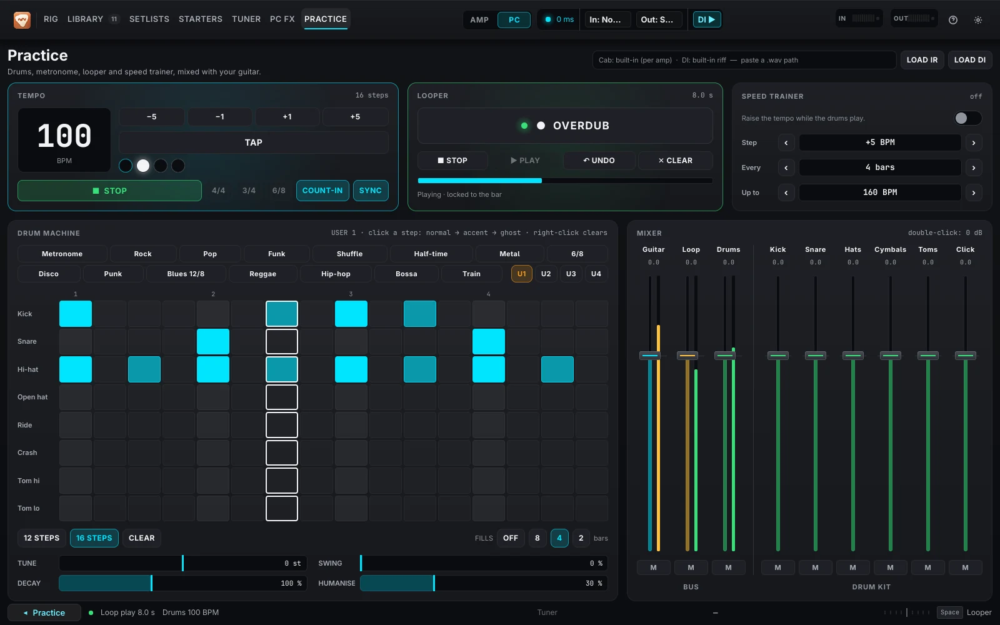
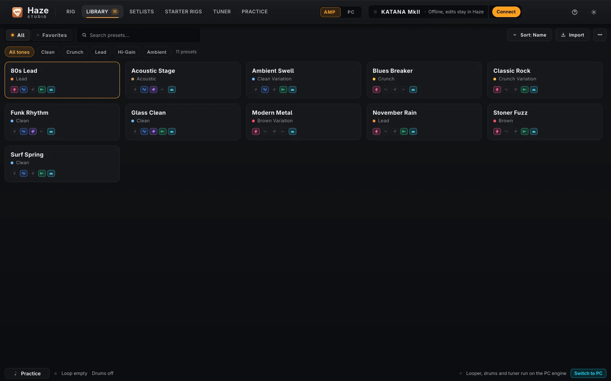
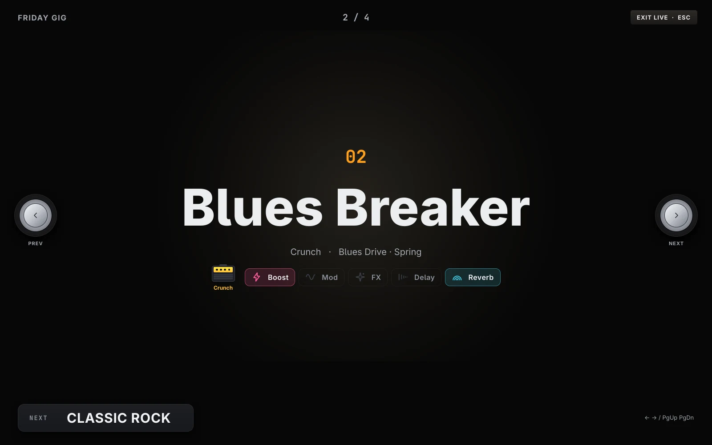
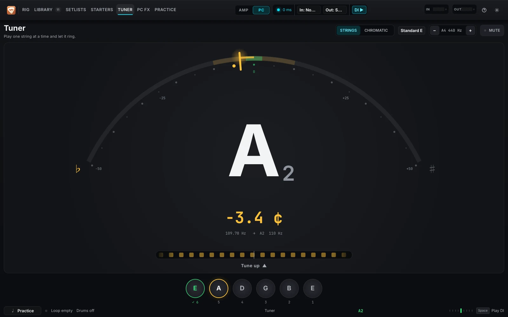
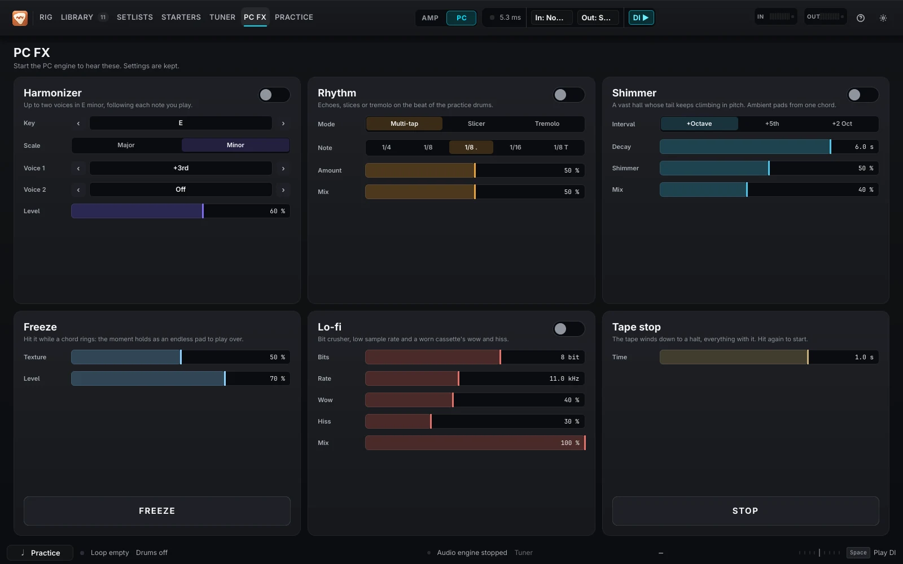

<div align="center">



# Haze

**A tone editor, librarian and practice rig for the BOSS KATANA MkII on Linux and Windows, written in Rust and drawn on the CPU.**

[](https://github.com/wiktor-jozwiak/haze/releases)
[](https://github.com/wiktor-jozwiak/haze/stargazers)
[](LICENSE)
[](Cargo.toml)
[](#credits)

<br>



<table>
  <tr>
    <td align="center" width="33%"><h3>56 MB</h3><sub>memory of the whole app, PC engine running</sub></td>
    <td align="center" width="33%"><h3>0</h3><sub>OpenGL or Vulkan contexts in the process</sub></td>
    <td align="center" width="33%"><h3>4.8 %</h3><sub>of one core for the full effect chain, every block on</sub></td>
  </tr>
</table>

**[Tour](#tour) · [What you get](#what-you-get) · [Why it is light](#why-it-is-light) ·
[Download](#download) · [Real numbers wanted](#real-numbers-wanted) · [Develop](#develop)**

</div>

Haze talks to the amp the way BOSS Tone Studio does, over USB MIDI and SysEx, and adds what Tone Studio
never had: a Linux version, a library you can search, setlists, a stage view, and a practice room with drums,
a looper and a speed trainer. When the amp is not plugged in, the same rig runs on the computer through
any audio interface.

| | What it does | Needs |
|---|---|---|
| **Amp mode** | edits the KATANA MkII live: every block, the chain order, A/B, undo; reads and writes its channels | the amp on USB |
| **PC mode** | plays the rig on the computer: amp models, effects, cab IR, tuner, drums, looper | an audio interface, or just a DI file |

> [!NOTE]
> Haze is one person's daily amp editor (Arch / CachyOS, a KATANA MkII, a cheap USB interface). It is
> shared because it works, not because it is finished: expect rough edges, and expect to read some code.
> The command line still speaks Polish; the window speaks English.
> The Windows build is new: it is built and smoke-tested in CI on every push, but has far fewer
> hours with a real amp than the Linux one. Reports welcome.

## Tour

<div align="center">

<table>
  <tr>
    <td width="50%" align="center"><br><sub>Amp mode: the chain is what the KATANA holds right now</sub></td>
    <td width="50%" align="center"><br><sub>Practice: drum grid, looper, speed trainer and a mixer with meters</sub></td>
  </tr>
  <tr>
    <td align="center"><br><sub>Library: every tone, searchable, with its amp and its chain</sub></td>
    <td align="center"><br><sub>Stage view: a setlist you can read from two metres away</sub></td>
  </tr>
  <tr>
    <td align="center"><br><sub>Tuner on the PC engine</sub></td>
    <td align="center"><br><sub>PC FX: blocks the amp does not have, on the PC engine</sub></td>
  </tr>
</table>

</div>

## What you get

**Editor.** The signal chain as a pedalboard: click a block to open it, drag it to reorder, every knob of
every block. A/B compare, undo and redo, the amp-type selector as on the real panel, 33 amp models.
Edits go to the amp's temporary patch first, so nothing is stored until you say so.

**Library and setlists.** Tones live as plain files under `~/.local/share/katana-studio`. Import from
BOSS Tone Studio `.tsl` files, or point `haze import-windows` at a mounted Windows partition and it finds
the Tone Studio folder on its own. Favourites, starter rigs, setlists with a fullscreen stage view that
turns pages with arrow keys or PgUp / PgDn (what most foot controllers send).

**PC engine.** The rig rendered on the computer: preamp and power amp, cab impulse response, the
effects, plus a few models and FX blocks the amp itself does not have. Play through an interface, or
press Space to run a DI file through it at 2 in the morning without waking anyone.

**Practice room.** A page of its own:

- drums: 15 grooves (rock, funk, shuffle, metal, disco, punk, blues 12/8, reggae, hip-hop, bossa,
  train and more) plus 4 user grooves on a 16-step grid; copy a preset into a user slot and edit it
- kit: tune, decay, humanize, swing, fill frequency, and a level per voice group (kick, snare, hats,
  cymbals, toms, click)
- looper: record, overdub, undo; waits for the bar line or counts in
- speed trainer: raises the tempo by itself every N bars up to a target
- mixer: guitar, looper and drums on faders with live meters, mute per channel; the looper records
  before the fader, so turning the guitar down does not empty your loop

**Tuner** on the PC engine, in a page of its own and in the status bar under every page.

## Why it is light

The window is [Slint] with its **software renderer**: no OpenGL, no Vulkan, no compositor-side GPU
buffer. It redraws only what changed. Audio runs on [cpal] with a lock-free ring between the window and
the audio thread, and the audio callback never allocates: a test counts every allocation on that thread
and fails on the first one.

How the numbers above were taken (Ryzen 7 5700X, 48 kHz, release build):

- **Memory**: PSS of the running process from `/proc/<pid>/smaps_rollup`, PC engine on, practice page open.
- **No GPU**: no `libGL`, `libEGL` or `libvulkan` mapped in `/proc/<pid>/maps`.
- **DSP load**: `cargo test --release -p haze-dsp --test realtime realtime_factor -- --nocapture` renders
  10 s of audio through the whole chain with every block on; it took 0.481 s.

<details>
<summary><b>More numbers</b></summary>

| What | Value | How |
|---|---|---|
| Memory (PSS), whole app, PC engine running | 56 MB | `smaps_rollup` |
| CPU, PC engine running, nothing played | 3.85 % of one core | `/proc/<pid>/stat`, 30 s |
| Full chain, every effect on | 4.8 % of one core | `realtime_factor` test |
| Buffer latency, 128 frames at 48 kHz | 5.3 ms | in + out buffer, shown in the top bar |
| Allocations in the audio callback | 0 | `process_never_allocates` test |
| Bare drum kit vs. a DI guitar before the mix fix | 18–24 dB quieter | `mixer_balance_drums_against_guitar` test |
| Tests | 107 | `cargo test --release` |
| Golden screenshots, compared pixel by pixel | 14 views | `haze snapshot-check` |

</details>

## Download

| | Get | Then |
|---|---|---|
| **Windows 10 / 11** | [haze-windows-x86_64.zip](https://github.com/wiktor-jozwiak/haze/releases/latest/download/haze-windows-x86_64.zip) | unzip, run `haze.exe` |
| **Linux x86_64** | [haze-linux-x86_64.tar.gz](https://github.com/wiktor-jozwiak/haze/releases/latest/download/haze-linux-x86_64.tar.gz) | unpack, run `./install.sh` |

**Windows:** install the [BOSS KATANA MkII driver](https://www.boss.info/global/support/by_product/katana_mkii/updates_drivers/)
first (the one Tone Studio uses) and close Tone Studio while Haze runs: only one program can hold the
amp's MIDI port. The exe is portable and not code-signed, so SmartScreen asks once (*More info → Run anyway*).
The library lives in `%APPDATA%\katana-studio`, and your Tone Studio library is found automatically.

**Linux:** any glibc 2.35+ distro (Ubuntu 22.04, Debian 12, Fedora 36, Arch) with ALSA and fontconfig,
Wayland or X11. `install.sh` puts `haze` in `~/.local/bin` with its icon and menu entry, no root:

```sh
tar xzf haze-linux-x86_64.tar.gz && haze-linux-x86_64/install.sh
```

Every release lists `SHA256SUMS` next to the files. All builds: [Releases](https://github.com/wiktor-jozwiak/haze/releases).

### Build from source

You need Rust (stable). On Linux also the ALSA headers.

```sh
# Arch / CachyOS
sudo pacman -S --needed rust alsa-lib
# Debian / Ubuntu
sudo apt install cargo libasound2-dev libfontconfig-dev libxkbcommon-dev
```

```sh
git clone https://github.com/wiktor-jozwiak/haze
cd haze
packaging/install.sh      # builds, installs ~/.local/bin/haze, the icon and the menu entry
```

Plug the amp in over USB and open **Haze** from the menu. No amp? Press **PC** in the top bar, choose
your interface, or press **DI ▶** to hear the rig on a recording.

From the command line:

```sh
haze import ~/Downloads/my-tones.tsl   # a .tsl file or a Tone Studio folder
haze import-windows                     # find Tone Studio (on Linux: on a mounted Windows partition)
haze list                               # every tone in the library
haze probe "80s Lead"                   # hardware check: connect, audition, read back
```

## Real numbers wanted

Everything on this page was measured on one machine with one amp. That is a sample of one. If you run
Haze, the most useful thing you can send back is **your real numbers**, not impressions:

- your amp (KATANA 50 / 100 / Head / Artist MkII) and firmware, and whether Amp mode connects
- your interface and the latency the top bar shows at 64 / 128 / 256 frames, and if you hear dropouts
- memory and CPU on your machine: `grep Pss /proc/$(pidof haze)/smaps_rollup` and `pidstat -p $(pidof haze) 1 30`
- a real `.tsl` export that imports wrong, with what Tone Studio shows for it

Open an issue with the numbers and the command you used. A bad number with a method beats a good
number without one.

## Develop

```sh
cargo build --release
cargo test --release
./target/release/haze snapshot-check crates/katana-studio/tests/golden   # UI against golden PNGs
./target/release/haze --png out.png --size 1600x1000                     # render the window offscreen
```

Useful variables: `KATANA_STUDIO_LIBRARY` (another library folder), `HAZE_PAGE` (open on a page),
`HAZE_PC_MODE=1` (start on the PC engine).

| Path | What |
|---|---|
| `crates/katana-core` | the KATANA MkII parameter map, SysEx, the `.tsl` codec, the library |
| `crates/katana-midi` | USB MIDI: connect, read and write the amp |
| `crates/haze-dsp` | the PC engine: amp, cab, effects, tuner, drums, looper; realtime-safe |
| `crates/katana-studio` | the `haze` app: Slint UI, pages, golden screenshot tests |
| `crates/katana-art` | generated textures for the hardware look |
| `vendor/cpal` | cpal 0.15.3 with a fix for ALSA capture after an overrun and WASAPI rate conversion |
| `packaging/` | icon, desktop entry, `install.sh`, Windows `.ico` and readme |
| `.github/workflows/build.yml` | tests, Linux + Windows builds; a `v*` tag publishes the release |

## Credits

Built on [Slint], [cpal], [midir], [rtrb], [RealFFT] and [hound].
Haze is developed with the help of [Claude] by Anthropic: a lot of the code, the tests and this page
were written together with it. The numbers on this page come from the code and the machine, not from
the model: each one has the command that produced it.

<sub>Haze is not affiliated with BOSS or Roland. BOSS, KATANA and BOSS Tone Studio are trademarks of
Roland Corporation, named here only to describe what the program works with.</sub>

[MIT](LICENSE)

[Slint]: https://slint.dev
[cpal]: https://github.com/RustAudio/cpal
[midir]: https://github.com/Boddlnagg/midir
[rtrb]: https://github.com/mgeier/rtrb
[RealFFT]: https://github.com/HEnquist/realfft
[hound]: https://github.com/ruuda/hound
[Claude]: https://claude.ai
